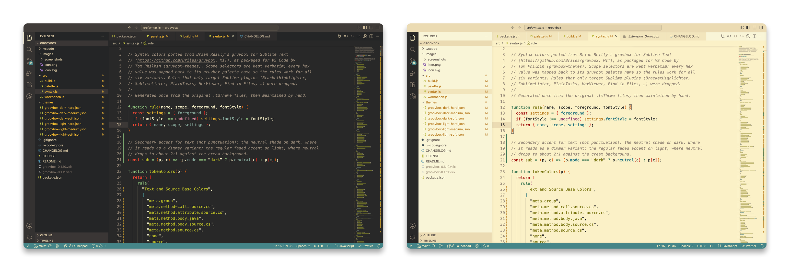

# Groovbox

A modern take on [gruvbox](https://github.com/morhetz/gruvbox) by Pavel Pertsev
for VS Code. Code colors come from Brian Reilly's
[gruvbox for Sublime Text](https://github.com/Briles/gruvbox), taken from Tom
Philbin's VS Code port,
[Gruvbox Themes](https://github.com/tomphilbin/gruvbox-themes-vscode).
This adds the full UI and semantic highlighting.

## Variants

- **Groovbox Dark**
- **Groovbox Light**

Both use gruvbox's default (medium) contrast.

## Screenshots



Groovbox Dark (left) and Groovbox Light (right).

## Install

```sh
code --install-extension groovbox-<version>.vsix    # VSCodium: codium …
```

Then pick a **Groovbox** theme in *Preferences: Color Theme*.

## Semantic highlighting

The themes turn semantic highlighting on. When a language server provides
semantic tokens, function calls, method calls and declarations keep the
Sublime colors. Everything else uses the same colors as without it.

## Build

```sh
npm run build      # regenerate themes/ from src/
npm run package    # create the .vsix
```

## License

MIT. See `LICENSE`.
